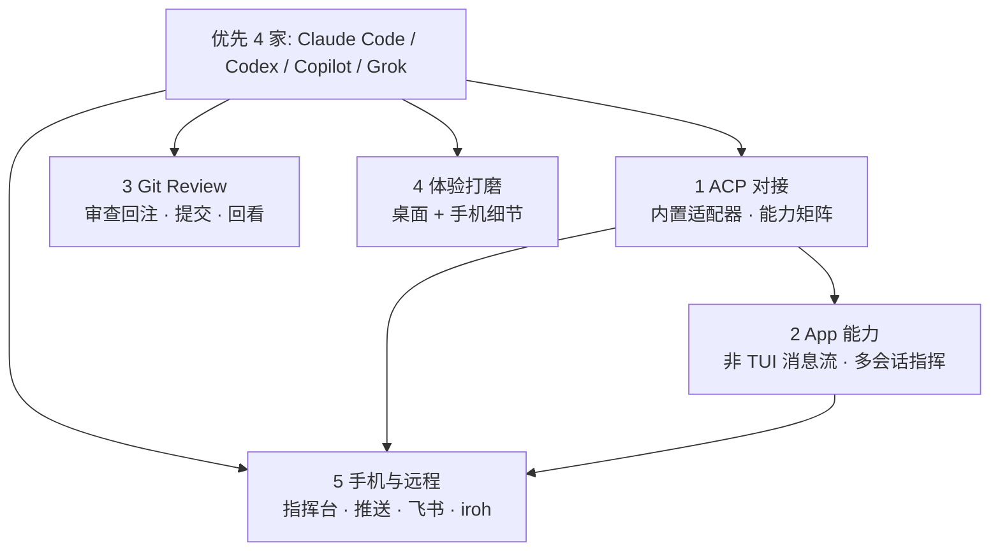
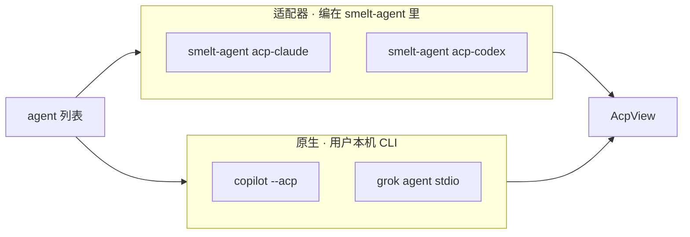
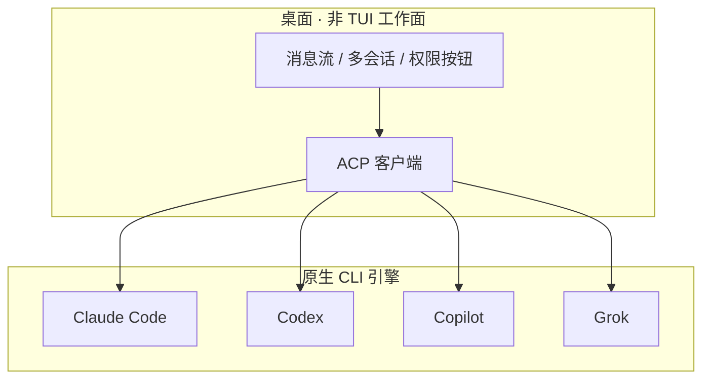
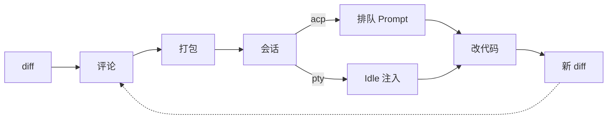
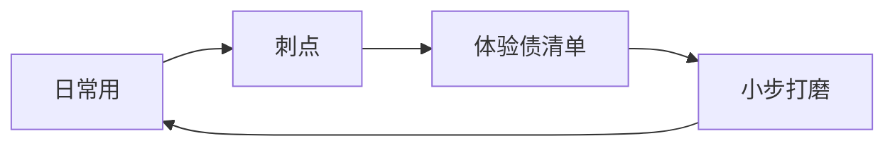
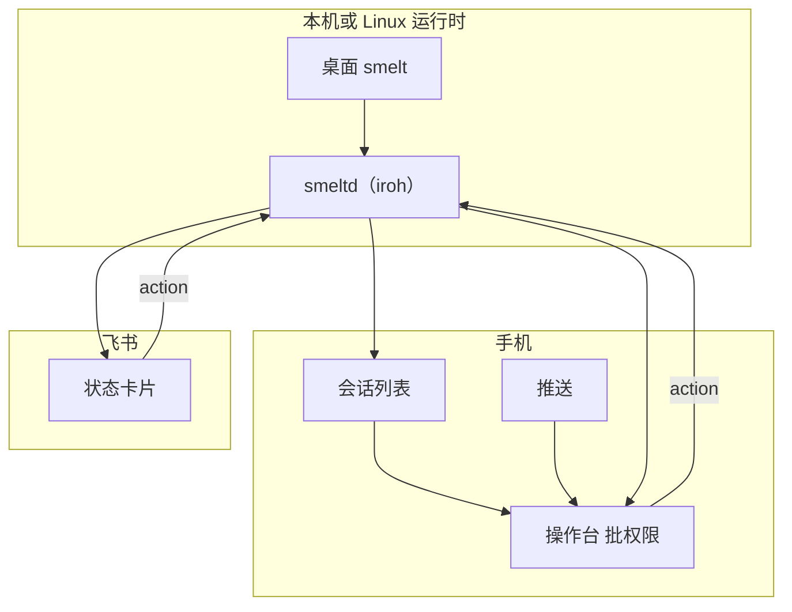

# smelt 产品路线图 · 待做

**优先支持的 4 家 agent：** Claude Code · Codex · Copilot · Grok
（原生能力已扩展到 Cursor / OpenCode / Kiro；Pi 由 Smelt 直接驱动官方
JSONL RPC，不经 ACP。其它 CLI 可走 custom，不保证体验。）

对标 Codex Desktop：**多 provider 结构化对话 · App 工作面 · Review · 手机远程 · 体验增强**
约束：PTY/结构化对话二选一 · 权限门不关 · 引擎在本机 · 远程只指挥不搬服务器

杂项点子 → [`roadmap.md`](roadmap.md) · 桌面插件化进度 → [`app-plugins.md`](app-plugins.md)

---

## 产品级智能体基线

产品模型固定为 `AgentDefinition → Conversation / Automation → AgentRun → Engine`：智能体是长期存在的产品对象，不是进程或对话；同一定义可以创建多段 Conversation，自动化也能在没有 Conversation 时创建 Run。定义只保存名称、长期指令和引擎；普通 Conversation 的工作目录来自会话上下文，Automation 可以选工作目录，不选时由 daemon 分配稳定工作区（智能体的在它 space 下的 `automations/`，Shell 的在 `~/.smelt/workspaces/automations`），账号/profile、模型与输入仍属于每次 Conversation/Run。Pi 是第一阶段唯一注册的执行引擎。左侧「智能体」负责定义管理，「自动化」独立管理触发条件、每次输入与运行状态；对话仍是普通 Session，并只引用智能体 ID。

股票数据、飞书 `chat watch` 和通知目标都属于 Smelt capability/plugin 与 source/trigger/sink 层。Pi 只负责理解目标、规划和调用宿主授予的能力，不直接拥有这些业务插件。定时是首个内置触发方式：由 `smeltd` 持续 claim 到期项并创建独立 Run，不要求先有对话或保持 GUI 打开。手动「运行一次」复用同一 Run 生命周期，但不推进定时游标。飞书监听应作为 daemon 托管的连接器/事件源，由自动化订阅其事件，而不是硬编码进智能体定义或 Pi 引擎。

---

## 总览



---

## 1 · Agent 协议对接

**不是四家都「CLI 本体原生讲 ACP」。** smelt 对 Claude、Copilot、Grok 做 ACP
客户端；Codex 出厂默认走 `@agentclientprotocol/codex-acp` 标准 ACP 通道（`default_acp_codex_cmd()`），
旧的 `codex app-server` 仅兼容手填旧存档。各家再归一化到同一套会话事件。

| Provider | 协议形态 | smelt 怎么交付 | 启动（出厂默认） |
|----------|----------|----------------|------------------|
| **Claude** | **适配器**（`claude-agent-acp`） | 编在 `smelt-agent` 里，跑本机 Claude CLI | 逻辑名，运行时换成 `smelt-agent acp-claude` |
| **Codex** | **标准 ACP 通道**（`codex-acp`） | 编在 `smelt-agent` 里，跑本机 Codex CLI | 逻辑名，运行时换成 `smelt-agent acp-codex` |
| **Copilot** | **原生**（CLI 内置 ACP server） | 用户本机已装 `copilot`；smelt 不代装 CLI | `copilot --acp --stdio` |
| **Grok** | **原生**（Grok Build 官方 ACP） | 用户本机已装 / 官方入口；smelt 不代装 CLI | 以官方 `agent stdio` 为准 |
| **Pi** | **官方 JSONL RPC** | Smelt 原生驱动；Pi 编成 `smelt-agent`，复用 Pi 配置/凭据 | `smelt-pi-agent` |

适配器版本钉在 `agent/package.json`，跟着 smelt-agent 一起升级。出厂默认命令换过写法时，
Smelt 只把自己曾发布过的逐字默认命令迁到当前默认；带环境前缀、额外参数或替换过运行器的
用户命令保持不动。新会话和断线/手动重启后的会话使用新版本，正在执行的进程不热切换。

```text
原生   = agent 进程自己实现 ACP
适配器 = 另起进程，把 Claude 私有协议翻译成 ACP
原生 RPC = smelt 直接消费 provider 公开的进程协议，不先翻译成 ACP
app-server = smelt 直接消费 Codex 的原生 JSONL 协议
```

### 适配器：编在 smelt-agent 里

Claude、Codex 的官方 ACP 适配器和 Pi 一起编进 `smelt-agent`，**用户不必自己装 node/npx/适配器**，
也不另外下载 Bun。MCP 预设需要的 `bun x` 同样用 smelt-agent（`BUN_BE_BUN=1`）。

**仍须用户自备的（smelt 不代装）：**  
- Claude 适配器背后的 **Claude Code / 登录**  
- Codex 的 **Codex CLI / 登录**
- Copilot / Grok 的 **本机 CLI + 鉴权**（原生，无适配器可代下）
- Pi 的模型凭据或已有 `~/.pi/agent` 配置（对话模式不要求安装 Pi CLI）

能力与权限语义（尤其 `request_permission`）**逐家实测**，不假设「接了 ACP = 会弹权限门」。

- [x] **可配置的 agent 列表**（替单一 `acp_cmd`）：内置 agent 用出厂命令（静态注册表 `CONVERSATION_AGENTS`）；要换命令、加参数、换数据目录用「自定义 Agent」
- [x] Claude、Codex 适配器锁定版本并编进 `smelt-agent`；Codex 走标准 `codex-acp` 通道
- [x] Pi 原生 RPC 驱动：编译好的 `smelt-agent`、锁定依赖、流式/工具/权限/取消/恢复、模型与推理配置
- [x] 侧栏选用哪家 agent；会话记住选的是谁；UI 标注「适配器（smelt 代管）/ 原生（需本机 CLI）」
- [x] 连接层下沉 `smelt-core`（`crates/smelt-core/src/acp_conn.rs`）并由 `smeltd` 托管 ACP
- [ ] 逐家实测矩阵：`session/load` · `request_permission` · elicitation
- [ ] 启动命令支持引号；下载/拉包错误可读；adapter 版本可锁可升



---

## 2 · App 能力（ACP 工作面）

**给谁用：** 不喜欢盯 TUI / 不会用终端交互的用户——用原生消息流界面指挥 agent，不必读 ANSI 画面、不必在 TUI 里找权限菜单。  
**定位：** 各家 **原生 CLI**（Claude Code / Codex / Copilot / Grok）经 ACP 接进桌面，做出类似 **NioChat** 的多会话指挥体验——**CLI 当引擎、smelt 当驾驶舱皮肤**，不是再包一层模型 API。PTY 通道仍保留，给需要完整 TUI 的人。

**可参考：**
- **Codex App / Claude Code 桌面** —— 按项目组织多线程、消息流而非盯 TUI、并行长任务、权限/工具可视化
- 同类：AgentHub、Devin Desktop ACP 面板等（只抄「多 agent 工作面」，不抄杀进程/重服务端）

### 待做

- [x] **P0 消息流工作面**（对标 Codex/Claude 桌面）：tool 卡片折叠 · 行内/附件 diff · turn 中 prompt 排队 · 交接与分叉（`session_handoff.rs` / Pi `--fork`）
- [ ] **P1 多会话指挥**：同项目多线程体验打磨 · 一键再开/换 provider · 文件/diff content block
- [ ] **P2** 会话内搜索 · `terminal/*` 代跑真 PTY + 会话内终端面板




---

## 3 · Git · Review

**目标体验：** 在 smelt 内走完 **改动 → 审查 → 回注 agent → 再 diff → 提交 → 回看** 整条链路，不必跳到别的 Git 客户端或飞书里搬评论。

- [x] **审查与回看基础：** diff 行内选区评论回注（`crates/plugins/git/src/panel/diff.rs`）、Git log / 分支图 / 单 commit diff（`crates/plugins/git/src/log_view.rs`）、任务工作树及关闭保护（`crates/smelt-git/src/worktree.rs`）
- [ ] **提交体验：** stage/commit/push 手感打磨 · AI commit message · 提交后可一键回到该次 diff · 评论与 commit/sha 关联回溯
- [ ] 从 diff/tool 跳文件定位 · 外部变更提示 · 分支/stash
- [ ] 联机 review（后置，同一回注管道）



---

## 4 · 任务

本地任务看板、`TaskRun` 调度、任务总览页和 `task.create` 插件契约已经下线。
执行现场就是会话（ACP / 终端）和自动化 Run；不再恢复独立任务产品面。

---

## 5 · 体验增强

功能以「能用」为主，细节粗糙。不扩大盘，把已有能力打磨到顺手。

| 面 | 待磨（示例，滚动补充） |
|----|------------------------|
| **终端** | 光标闪烁 · 选区/滚动/粘贴边角 · 重绘与帧感 · 链接/IME 边角 · 空闲与刷屏手感 |
| **侧栏 / 会话** | 标题与相位可读 · 通知不过噪 · 总览卡片信息密度 · 分屏/焦点/快捷键一致 |
| **Git / 文件** | diff 可读与操作反馈 · 大仓性能 · 保存/冲突提示 · 空态与错误文案 |
| **ACP 消息流** | 流式阅读 · 权限卡片布局 · 长 tool 折叠默认策略 · 错误/重连文案 |
| **手机远程** | 小屏信息密度 · 通知与深链 · 弱网/断线重连文案 |
| **设置 / 新手** | 首次引导 · 缺 CLI/未登录可读提示 · 设置项分组与搜索 |
| **全局** | 主题/间距/字号统一 · 加载与空态 · 快捷键表与可发现性 · 窗口/布局恢复边角 |

- [ ] 维护体验债清单，按痛感排序
- [ ] 高频路径优先：开会话 → 看状态 → 批权限（含手机）→ 看 diff → 提交



---

## 6 · 手机与远程

**目标体验：** 人不在电脑前，也能知道 agent 卡在哪、一点允许/拒绝、必要时短回复——**手机是指挥台，不是第二块小终端。**  
引擎与会话仍在那台机器的 smeltd。手机和另一台桌面都是运行时的客户端，走 iroh，不经过网关。飞书卡片还没做。

已落地（细节在 [`workspace.md`](workspace.md)）：Flutter 手机 App 同时连所有配对过的机器，看对话和终端、批权限、离线 SQLite 缓存；一次性配对码；Linux 无头 `smeltd`；Windows 本机 `smeltd`（x86_64 安装包与桌面应用内更新，不签名）；一个桌面窗口挂多台运行时；远程桌面（noVNC）能看能接管。

**给谁用：** 开会、通勤、下班后 agent 还在跑，不能坐回电脑的人。

### 手机端（主入口）

- [x] **会话列表**：各会话相位 · 角标 · 进详情（Flutter App）
- [x] **操作台（默认，非 xterm）**：首屏是跨机器指挥台，等你处理的审批、询问以单据挂在顶上，原地批 / 答（见 [`mobile/PRODUCT.md`](../mobile/PRODUCT.md)）
- [x] **ACP 会话**：结构化消息、权限/选择题、可发消息
- [x] **PTY 会话**：手机渲染运行时转发的终端流
- [x] 推送通知：等批准 / 等输入 / 失败 / 完成，按类型开关；勿扰交给 iOS 专注模式（APNs 经推送中继，见 [`push-relay-deployment.md`](push-relay-deployment.md)）
- [x] 深链：通知一点进对应会话。鉴权已是设备配对，不是长期 token
- [x] 弱网：断线提示、自动重连；离线先读手机本地 SQLite 缓存

### 连接与托管（本机侧）

- [x] smeltd 托管 **ACP** 子进程；GUI / 手机均可再连上
- [x] 桌面和手机共用 `smelt-runtime-client`（iroh 或本机 socket）
- [x] 公网可达：iroh P2P，默认可走 n0 公共 relay，也可自建；一次性配对码（10 分钟、用一次），设备可撤销
- [x] Linux 无头运行时（systemd 用户服务，`smeltd install` / `pair` / `devices`）与桌面多运行时
- [x] Windows 本机运行时（x86_64 安装包与应用内更新，不签名；远程升级待办见 [`windows-support.md`](windows-support.md)）
- [ ] 多端同时看不顶掉桌面 GUI；权限操作幂等、可审计

### 飞书（轻量通道，与手机共用 action）

- [ ] 状态变化推卡片（等批准 / 等输入 / 完成摘要）
- [ ] 卡片按钮 → `approve / deny / reply` → 本机会话
- [ ] 不嵌终端；收件箱零安装



---

## 剩余主线优先级

| 线 | 待推进内容 |
|----|------------|
| **桌面插件化** | 剩余 16 个 Rust 内置插件迁入 NSH JS/TSX 插件（见 [`app-plugins.md`](app-plugins.md)） |
| **ACP & App** | 逐家能力矩阵 · 引号参数与错误可读 · 文件/diff content block · 会话内搜索 · `terminal/*` 会话内终端面板 |
| **Review** | AI commit message · 评论挂 sha · 跳文件 / 分支 / stash · 联机 review（后置） |
| **体验** | §5 体验债清单按痛感滚动打磨 |
| **远程与通道** | 多端并发幂等与审计 · Windows 远程 `runtime_upgrade` · 飞书卡片推送与按钮 |
